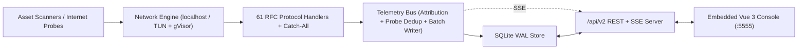

# ProtoSim — Protocol Scan Simulator & Probe Observatory

<p align="center">
  <b>English</b> | <a href="README.zh-CN.md">简体中文</a>
</p>

**ProtoSim** is a standalone, single-binary **protocol scan simulator and probe observatory** designed for developing/benchmarking asset scanners and capturing novel network probes in the wild.

---

## Key Features

- **61 RFC-Verified Protocols**: Covers web, remote access, databases, middleware, ICS/SCADA, IoT, and network infrastructure protocols, with full support for `localhost`, `userdef` (TUN + gVisor virtual subnet), and `all` networking modes.
- **Zero-Dependency SQLite WAL Store**: Built-in pure-Go SQLite (`modernc.org/sqlite`) with asynchronous batched writes, rolling retention (default 30 days / 2 GB), and **permanent preservation of deduplicated probes and pinned samples**.
- **Probe Library (Auto-Clustering)**: Deduplicates incoming probes by `(protocol, port, first_payload_sha256)`, tracking first/last seen, hit counts, unique source IPs, Hex/ASCII previews, triage status (`new` / `known` / `adopted`), and 1-click export to **Hex / Python / Go** reproducer snippets.
- **Scanner Attribution Engine**: Hot-reloadable rule engine matching `cidr`, `ua` (HTTP User-Agent), `ja3` (TLS fingerprint), and `payload_regex` to tag traffic (`nmap`, `zgrab`, `censys`, `shodan`, `masscan`, `self-scanner`, `unknown`, etc.).
- **Test Runs & 61-Protocol Coverage Matrix**: Start/stop named evaluation runs, inspect per-protocol coverage (`hit` / `missed` / `parse_error` / average latency), and diff any two runs side by side.
- **Full Session Replay & PCAP Export**: Captures bounded bidirectional payloads (64 KiB cap per session) — always persisting initial bytes even when protocol parsing fails or peers disconnect early — plus optional TCP/UDP **Catch-All** ports and 1-click Wireshark-ready `.pcap` export.
- **Embedded Vue 3 Console**: Single binary (`//go:embed`) bundling 7 observability views built with Vue 3 + Vite + TypeScript + Element Plus + ECharts, listening on `0.0.0.0:5555` by default.

---

## Architecture

See [docs/ARCHITECTURE.md](docs/ARCHITECTURE.md) ([简体中文](docs/ARCHITECTURE.zh-CN.md)) for module layout and database schema details.



---

## Quick Start

```bash
# 1. List all registered protocols and default ports
./bin/protosim list-protocols

# 2. Generate a ready-to-use configuration file (optional)
./bin/protosim gen-config -o protosim.json --scenario all-61-standard --safe-ssh=true

# 3. Start the simulator and Web UI (default: http://0.0.0.0:5555)
sudo ./bin/protosim run -c protosim.json --catch-all-tcp 9999 --catch-all-udp 9999
```

### CLI Flags (`protosim run`)

| Flag | Description | Default |
|---|---|---|
| `-c` | Path to JSON or YAML config file | Built-in 61-protocol config |
| `--listen` | Web UI & `/api/v2/*` listen address | `0.0.0.0:5555` |
| `--mode` | Network mode (`localhost` \| `userdef` \| `all`) | `localhost` |
| `--db` | SQLite database file path | `./data/protosim.db` |
| `--auth-token` | Enable Bearer / `X-API-Token` authentication | Disabled (LAN-friendly) |
| `--catch-all-tcp` | Comma-separated Catch-All TCP ports | Disabled |
| `--catch-all-udp` | Comma-separated Catch-All UDP ports | Disabled |
| `--safe-ssh` | Map simulated SSH to port `2222` instead of `22` | `true` |

---

## Building from Source

```bash
# 1. Build embedded Vue 3 frontend
cd web && npm install && npm run build && cd ..

# 2. Build standalone Go binary
go build -o bin/protosim ./cmd/protosim
```
