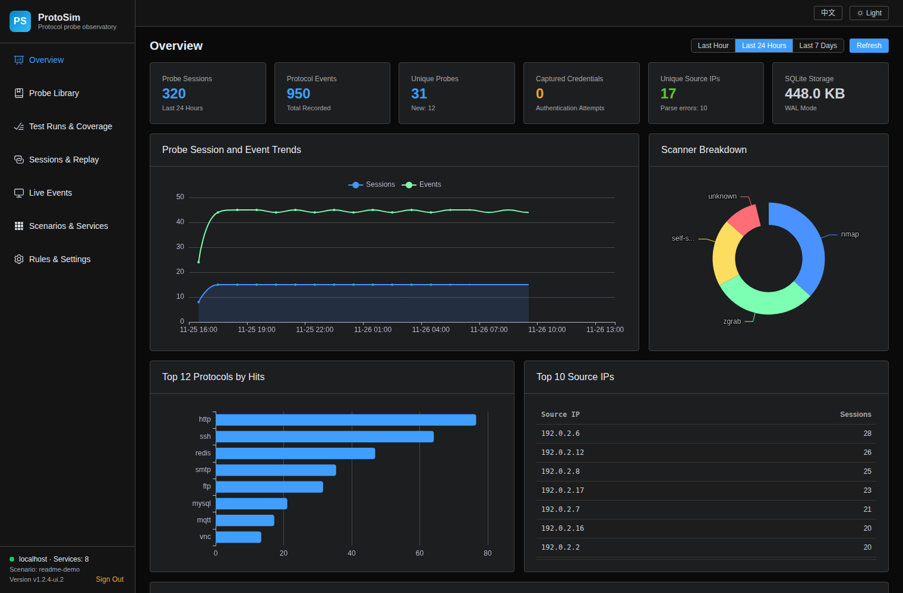
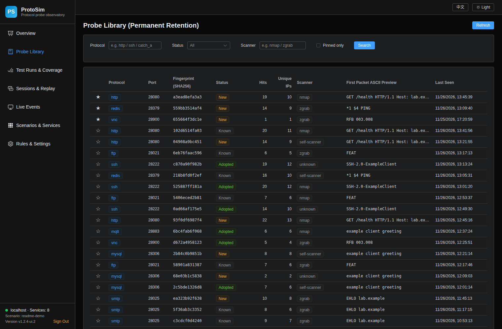
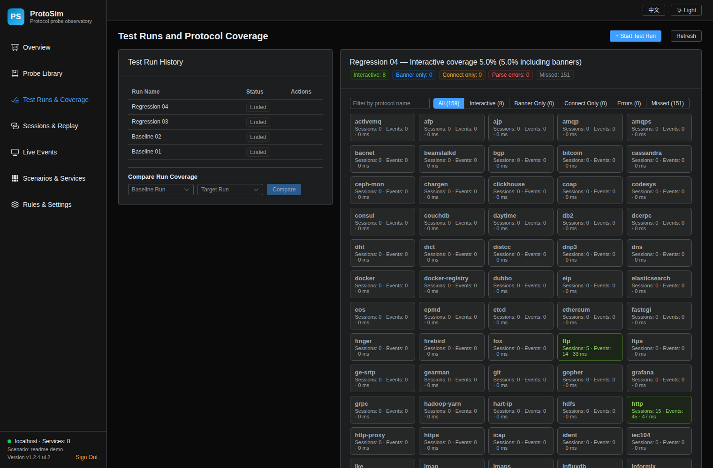
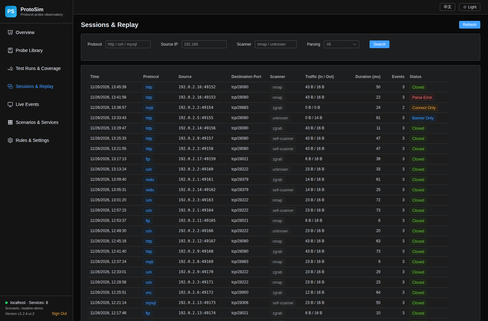
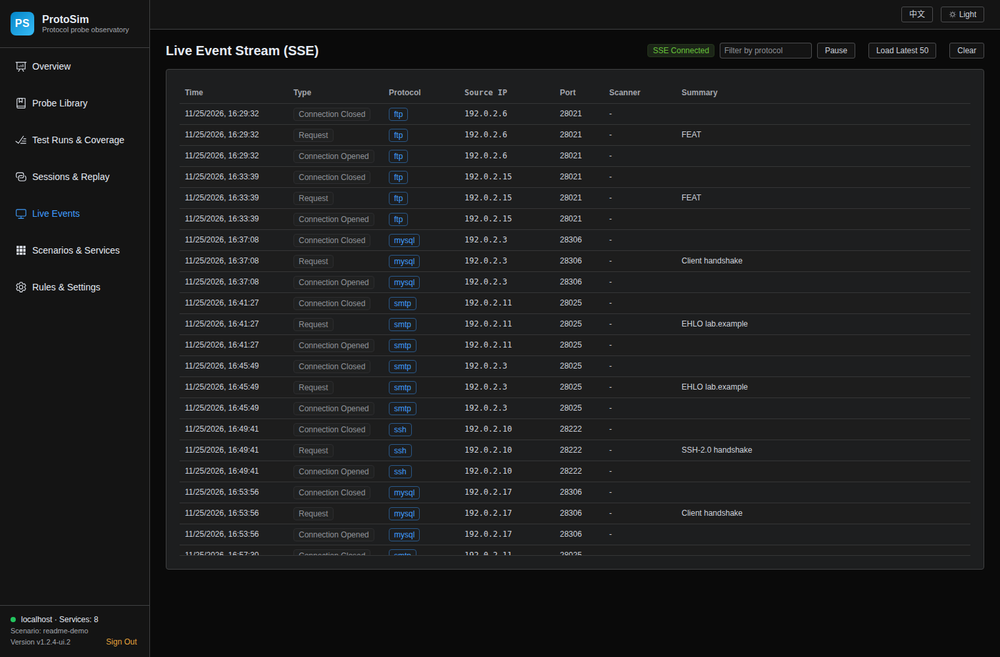
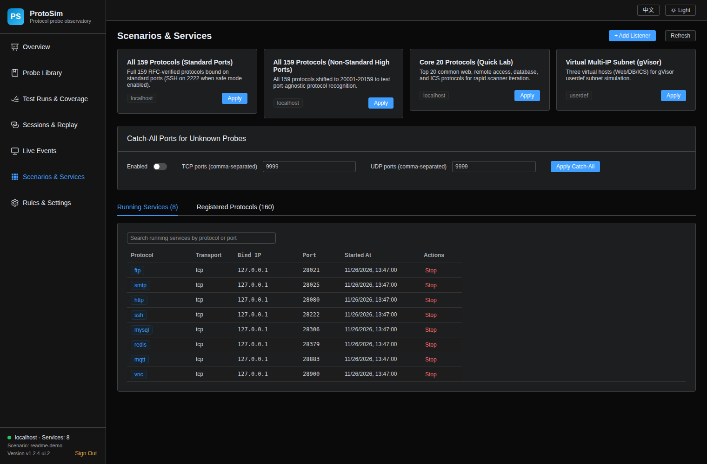
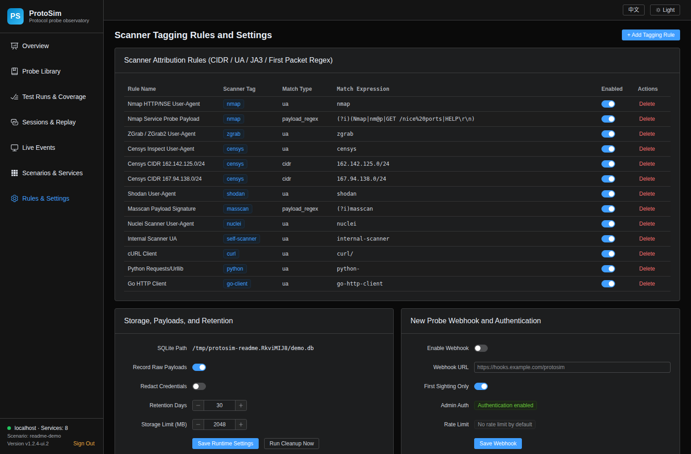
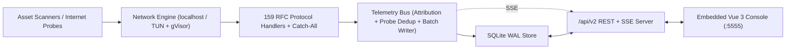

# ProtoSim — Protocol Scan Simulator & Probe Observatory

<p align="center">
  <b>English</b> | <a href="README.zh-CN.md">简体中文</a>
</p>

**ProtoSim** is a standalone, single-binary **protocol scan simulator and probe observatory** designed for developing/benchmarking asset scanners and capturing novel network probes in the wild.

---

## Key Features

- **159 RFC-Verified Protocols**: Full-spectrum protocol matrix covering web, remote access (`winrm`/`winrms`, `ssh`, `rdp`, `vnc`, `telnet`, `x11`, `xdmcp`, `rexec`/`rlogin`/`rsh`), out-of-band & printing (`ipmi`, `jetdirect`, `ipp`, `lpd`), databases & big data (`mysql`, `postgres`, `mssql`, `oracle/tns`, `mongodb`, `redis`, `clickhouse`, `couchdb`, `influxdb`, `neo4j`/`bolt`, `solr`, `hadoop-yarn`, `hdfs`, `firebird`, `db2`, `informix`, `sybase`, `ceph-mon`), cloud-native & DevOps (`k8s-apiserver`, `kubelet`, `docker`, `docker-registry`, `etcd`, `consul`, `vault`, `prometheus`, `minio`, `grafana`, `kibana`, `jenkins`, `kafka`, `nats`, `zookeeper`, `epmd`, `stomp`, `gearman`, `beanstalkd`, `fastcgi`, `grpc`, `thrift`, `http-proxy`, `ajp`, `jdwp`, `activemq`, `dubbo`, `git`, `svn`, `distcc`), ICS/SCADA (`modbus`, `s7`, `bacnet`, `dnp3`, `eip`, `opcua`, `knx`, `hart-ip`, `codesys`, `proconos`, `iec104`, `fox`, `omron`, `ge-srtp`, `pcworx`, `melsecq-discover`, `redlion-crimson3`), and network/TLS/special infrastructure (`bgp`, `rip`, `nat-pmp`, `wireguard`, `kerberos`, `radius`, `tacacs`, `stun`, `openvpn`, `xmpp`, `rtmp`, `bitcoin`, `ipfs`, `minecraft`, `source-rcon`, `teamspeak`, `gopher`, `dict`, `mdns`, `irc`, `nntp`, `tftp`, `rsync`, `socks4/5`, `smtps`/`ldaps`/`imaps`/`pop3s`/`ftps`/`mqtts`/`amqps`).
- **Zero-Dependency SQLite WAL Store**: Built-in pure-Go SQLite (`modernc.org/sqlite`) with asynchronous batched writes, rolling retention (default 30 days / 2 GB), and **permanent preservation of deduplicated probes and pinned samples**.
- **Probe Library (Auto-Clustering)**: Deduplicates incoming probes by `(protocol, port, first_payload_sha256)`, tracking first/last seen, hit counts, unique source IPs, Hex/ASCII previews, triage status (`new` / `known` / `adopted`), and 1-click export to **Hex / Python / Go** reproducer snippets.
- **Scanner Attribution Engine**: Hot-reloadable rule engine matching `cidr`, `ua` (HTTP User-Agent), `ja3` (TLS fingerprint), and `payload_regex` to tag traffic (`nmap`, `zgrab`, `censys`, `shodan`, `masscan`, `self-scanner`, `unknown`, etc.).
- **Test Runs & 5-State Coverage Matrix**: Start/stop named evaluation runs, inspect per-protocol coverage across all 159 protocols with 5-state classification (`hit` / `banner_only` / `connect_only` / `parse_error` / `missed`, excluding empty TCP connects from effective hits), and diff any two runs side by side.
- **Full Session Replay & PCAP Export**: Captures bounded bidirectional payloads (64 KiB cap per session) — always persisting initial bytes even when protocol parsing fails or peers disconnect early — plus optional TCP/UDP **Catch-All** ports and 1-click Wireshark-ready `.pcap` export.
- **Embedded Vue 3 Console**: Single binary (`//go:embed`) bundling 7 observability views built with Vue 3 + Vite + TypeScript + Element Plus + ECharts, listening on `0.0.0.0:5555` by default.

---

## Screenshots

After signing in, use the controls at the top right to switch between English and Simplified Chinese or between light and dark mode. The browser remembers your selections. The seven console views below use the dark theme and sample data.

### 1. Dashboard (Trends, Protocol TopN & Scanner Attribution)


### 2. Probe Library (Auto-Clustering, Hex/ASCII Viewer & Python/Go Export)


### 3. Test Runs & 159-Protocol Coverage Matrix


### 4. Session Replay & Wireshark `.pcap` Export


### 5. Live Event Stream (SSE + Recent Preload)


### 6. Scenarios, 159 Services & Catch-All Orchestration


### 7. Scanner Attribution Rules & Runtime Settings


---

## Architecture

See [docs/ARCHITECTURE.md](docs/ARCHITECTURE.md) ([简体中文](docs/ARCHITECTURE.zh-CN.md)) for module layout and database schema details.



---

## Network Modes, Scale Support & Benchmarks

ProtoSim separates single-host protocol simulation from large virtual subnet simulation:

| Network Mode | Dispatch Mechanism | Virtual IP Scale | Privileges (Linux) | Best Fit |
|---|---|---|---|---|
| **`localhost`** | Upfront OS `net.Listen` / `net.ListenPacket` | Single host / host IPs | Non-root + `CAP_NET_BIND_SERVICE` | Daily 159-protocol scanner regression & public probe observatory |
| **`userdef`** | TUN + gVisor dynamic `tcp/udp.Forwarder` | `/24`–`/12` (exact IP + wildcard `0.0.0.0`) | `CAP_NET_ADMIN` / root | Multi-host topology simulation (Web/DB/ICS hosts with exact IP overrides) |
| **`all`** | TUN + gVisor dynamic `tcp/udp.Forwarder` | **`/16` (65,534 IPs) to `/12` (1,048,574+ IPs)** in O(1) memory | `CAP_NET_ADMIN` / root | Large subnet scans with subnet-wide baseline services + exact IP overrides; closed ports return authentic `TCP RST` |

### Verified Benchmarks (`v1.3.1`)

Measured on a 4-core LAN test host (`Intel Core i5-6400 @ 2.70GHz`, 15 GiB RAM, Linux 7.0, SQLite WAL with batched coalescing). All TUN benchmarks used **cross-subnet source IPs** (`192.168.124.15` → virtual subnet) with `payload_enabled: false`:

| Scenario / Mode | Address Space | Startup | TCP Full Interaction (`HTTP+MySQL+Redis`) | UDP Interaction (`TFTP+NetBIOS`) | Memory / FDs | Drop / Error Rate |
|---|---|---|---|---|---|---|
| **`localhost`** (156 services) | Host loopback | `< 0.5 s` | 2,000 reqs (64C): **5,302.7 QPS** (`p50=9.3ms`, `p95=19.8ms`) | 1,000 reqs (50C): **9,839.7 QPS** (`p50=3.0ms`, `p95=7.8ms`) | — | **0%** |
| **`userdef` (`/24`)** | 254 virtual IPs | **134 ms** | 1,000 reqs (64C): **4,712.1 QPS** (`p50=9.3ms`, `p95=18.5ms`) | 500 reqs (50C): **6,600.9 QPS** (`p50=3.3ms`, `p95=9.9ms`) | O(1) | **0%** (`0` warnings) |
| **`all` (`/16`)** | 65,534 virtual IPs | **118 ms** | 1,000 reqs (64C): **4,089.3 QPS** (`p50=13.6ms`, `p95=17.6ms`) | 500 reqs (50C): **4,757.3 QPS** (`p50=7.8ms`, `p95=10.3ms`) | `45.4 → 67.5 MB` / `14 FD` | **0%** (`0` warnings; closed-port RST `0.16ms`) |
| **`all` (`/12`, 1M+ IPs)** | **1,048,574 virtual IPs** | **117 ms** | 14,000 open + 1,000 closed RST (24C sustained): **753.7 QPS** (`p50=32.3ms`, `p95=60.7ms`) | 5,000 reqs (20C sustained): **2,633.6 QPS** (`p50=7.2ms`, `p95=8.8ms`) | Flat, `0` FD growth | **0% network drop, 0% telemetry drop** |

### Capacity Boundaries & Recommendations

- **1M+ IP Address Space (`/12` or larger)**: Fully supported out of the box with O(1) startup (~120 ms) and constant memory when using wildcard `0.0.0.0` baseline services plus optional exact-IP overrides.
- **Recommended Scan Rates**: Smoothly handles **low-to-medium rate full-protocol scans (hundreds to ~4,000 QPS)** with zero packet loss and zero telemetry queue drops. For 1M+ IP runs, set `storage.payload_enabled: false` and increase `network.max_conns` (e.g. `16384`).
- **Ultra-High-Rate Ceiling**: Single-TUN userspace gVisor is bounded by single-queue TUN I/O (~4k–5k full TCP QPS on 4 cores). Ultra-high-rate raw-packet scans (50k–100k+ PPS via Masscan/ZMap) are outside the single-TUN design target and would require kernel-level Linux `TPROXY`.

---

## Quick Start

```bash
# 1. List all registered protocols and default ports
./bin/protosim list-protocols

# 2. Generate a ready-to-use configuration file (optional)
./bin/protosim gen-config -o protosim.json --scenario all-standard --safe-ssh=true

# 3. Start the simulator and Web UI (default: http://0.0.0.0:5555)
sudo ./bin/protosim run -c protosim.json --catch-all-tcp 9999 --catch-all-udp 9999
```

### CLI Flags (`protosim run`)

| Flag | Description | Default |
|---|---|---|
| `-c` | Path to JSON or YAML config file | Built-in 159-protocol config |
| `--listen` | Web UI & `/api/v2/*` listen address | `0.0.0.0:5555` |
| `--mode` | Network mode (`localhost` \| `userdef` \| `all`) | `localhost` |
| `--db` | SQLite database file path | `./data/protosim.db` |
| `--auth-token` | Enable Bearer / `X-API-Token` authentication | Disabled (LAN-friendly) |
| `--catch-all-tcp` | Comma-separated Catch-All TCP ports | Disabled |
| `--catch-all-udp` | Comma-separated Catch-All UDP ports | Disabled |
| `--safe-ssh` | Map simulated SSH to port `2222` instead of `22` | `true` |

---

## Release Downloads

Choose the archive for your operating system and CPU. Verify it against `checksums.txt` from the same release. [GitHub Releases](https://github.com/dx86683-lab/protosim/releases)

| Platform | Archive suffix | Build | Startup |
|---|---|---|---|
| Linux x86-64 (`uname -m`: `x86_64`) | `linux-amd64.tar.gz` | Available through CGO and libpcap | Included |
| Linux ARM64 (`uname -m`: `aarch64`) | `linux-arm64.tar.gz` | Pure Go build | Included |
| macOS Intel | `darwin-amd64.tar.gz` | Pure Go build | Run in a terminal |
| macOS Apple silicon | `darwin-arm64.tar.gz` | Pure Go build | Run in a terminal |
| Windows x86-64 | `windows-amd64.zip` | Pure Go build | Run `protosim.exe` in a terminal |

The Linux amd64 release binary is built on Ubuntu 24.04 and needs compatible glibc and libpcap runtime libraries (`libpcap0.8t64` on Ubuntu 24.04). Use `ldd ./protosim` to check its shared libraries. Pure Go releases support protocol simulation, session recording and session PCAP export. Interface-level SYN, UDP and ICMP capture requires a CGO build with libpcap and appropriate packet-capture privileges.

### Run as a Linux systemd Service

The unit requires systemd 247 or newer. It runs ProtoSim as a non-root dynamic user and grants `CAP_NET_BIND_SERVICE` for ports below 1024. It uses the same paths on amd64 and arm64 and reads a root-owned configuration file through systemd credentials. The unit is intended for `localhost` mode with TCP/UDP sockets. TUN modes and interface-level packet capture require their own device access and privileges.

For a first install, run the following from the extracted Linux archive with Python 3 available. For a source build, use `bin/protosim` and [deploy/systemd/protosim.service](deploy/systemd/protosim.service) as the two install sources. Keep `/etc/protosim/config.json` and `/var/lib/protosim` when upgrading.

```bash
sudo install -D -m 0755 ./protosim /opt/protosim/protosim
sudo install -D -m 0644 ./protosim.service /etc/systemd/system/protosim.service
sudo install -d -m 0700 /etc/protosim

./protosim gen-config -o protosim.json --scenario all-standard --safe-ssh=true --listen 127.0.0.1:5555
python3 - <<'PY'
import json
from pathlib import Path

path = Path("protosim.json")
config = json.loads(path.read_text())
for host in config["hosts"]:
    host["ip"] = "127.0.0.1"
config["storage"]["db_path"] = "/var/lib/protosim/protosim.db"
path.write_text(json.dumps(config, indent=2) + "\n")
PY
sudo install -m 0600 ./protosim.json /etc/protosim/config.json

sudo systemctl daemon-reload
sudo systemctl enable --now protosim
curl --fail http://127.0.0.1:5555/api/v2/health
```

The example binds the console and simulated services to loopback. Simulated SSH uses `2222`. Standard ports already occupied by another service still require a free bind address or a different port. Check the running service count through the console or API and review bind errors with `journalctl -u protosim`.

For a separate test machine, set `hosts[].ip` to the server's test interface address and add the machine's source address as `IPAddressAllow=` in a systemd drop-in. Allow the required TCP and UDP ports from the same source in the host firewall or cloud security group. Keep the console on loopback for SSH forwarding or configure authenticated access over HTTPS.

For a foreground run on macOS, use `./protosim run -c protosim.json`. On Windows PowerShell, use `.\protosim.exe run -c protosim.json`.

---

## Building from Source

```bash
# 1. Build embedded Vue 3 frontend
cd web && npm install && npm run build && cd ..

# 2. Build standalone Go binary
go build -o bin/protosim ./cmd/protosim
```
