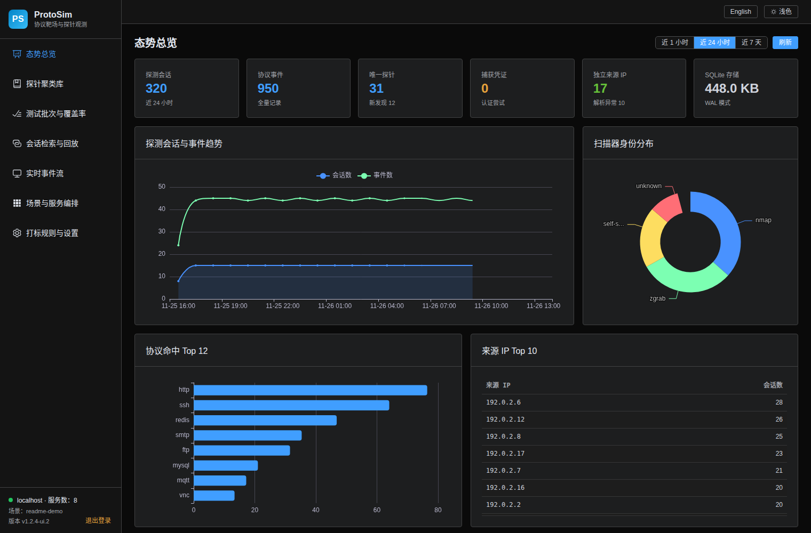
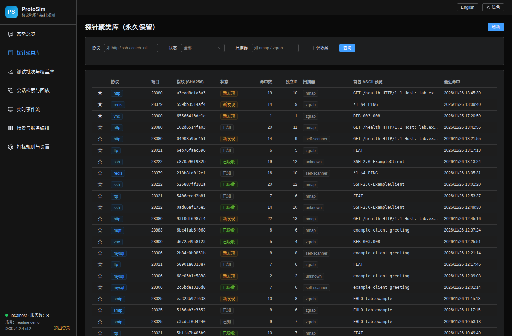
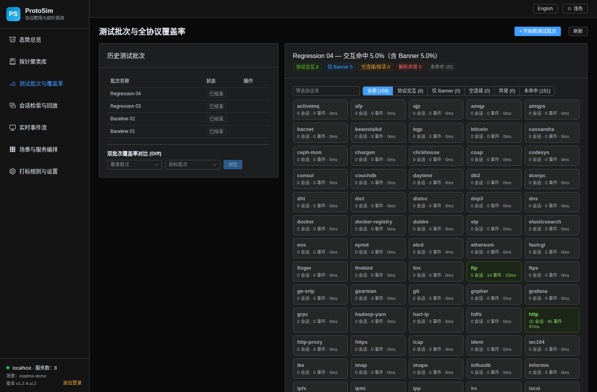
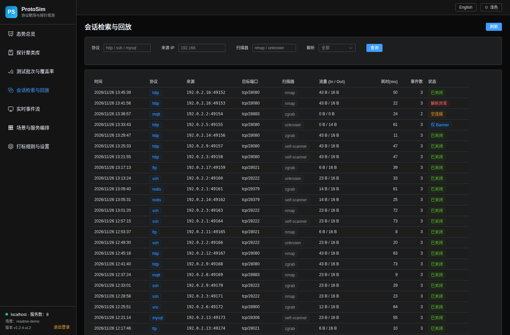
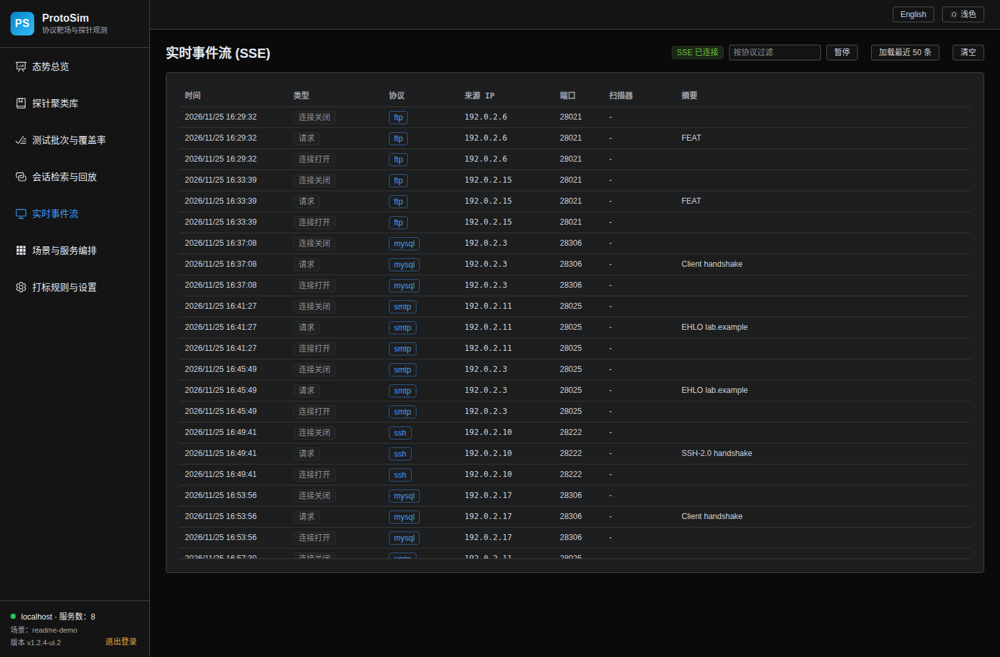
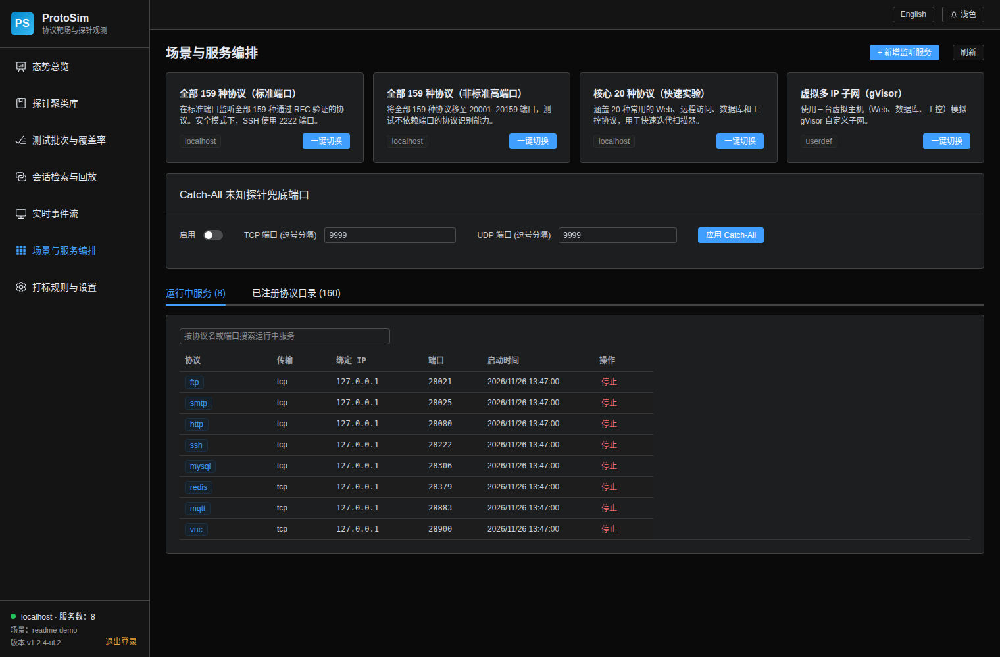
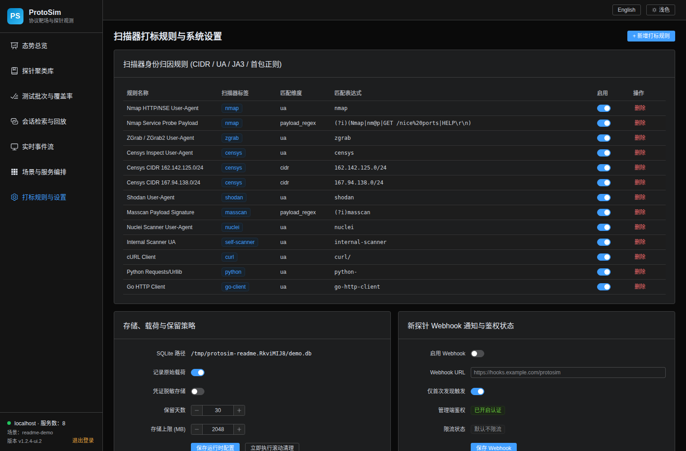

# ProtoSim — 协议扫描模拟器与探针观测平台

<p align="center">
  <a href="README.md">English</a> | <b>简体中文</b>
</p>

**ProtoSim** 是一款面向资产扫描器研发回归测试与公网扫描探针观测的**单机一体化协议模拟与遥测平台**。

---

## 核心特性

- **全量 159 种 RFC 级协议**：覆盖 Web、远程访问（`winrm`/`winrms`、`ssh`、`rdp`、`vnc`、`telnet`、`x11`、`xdmcp`、`rexec`/`rlogin`/`rsh`）、带外与打印（`ipmi`、`jetdirect`、`ipp`、`lpd`）、数据库与存储（`mysql`、`postgres`、`mssql`、`oracle/tns`、`mongodb`、`redis`、`clickhouse`、`couchdb`、`influxdb`、`neo4j`/`bolt`、`solr`、`hadoop-yarn`、`hdfs`、`firebird`、`db2`、`informix`、`sybase`、`ceph-mon`）、云原生与 DevOps（`k8s-apiserver`、`kubelet`、`docker`、`docker-registry`、`etcd`、`consul`、`vault`、`prometheus`、`minio`、`grafana`、`kibana`、`jenkins`、`kafka`、`nats`、`zookeeper`、`epmd`、`stomp`、`gearman`、`beanstalkd`、`fastcgi`、`grpc`、`thrift`、`http-proxy`、`ajp`、`jdwp`、`activemq`、`dubbo`、`git`、`svn`、`distcc`）、工控与物联网（`modbus`、`s7`、`bacnet`、`dnp3`、`eip`、`opcua`、`knx`、`hart-ip`、`codesys`、`proconos`、`iec104`、`fox`、`omron`、`ge-srtp`、`pcworx`、`melsecq-discover`、`redlion-crimson3`）及网络/TLS/公网长尾（`bgp`、`rip`、`nat-pmp`、`wireguard`、`kerberos`、`radius`、`tacacs`、`stun`、`openvpn`、`xmpp`、`rtmp`、`bitcoin`、`ipfs`、`minecraft`、`source-rcon`、`teamspeak`、`gopher`、`dict`、`mdns`、`irc`、`nntp`、`tftp`、`rsync`、`socks4/5`、`smtps`/`ldaps`/`imaps`/`pop3s`/`ftps`/`mqtts`/`amqps`），支持 `localhost`、`userdef`（TUN + gVisor 虚拟子网）与 `all` 三种组网模式。
- **零外部依赖的 SQLite WAL 观测库**：内置纯 Go SQLite（`modernc.org/sqlite`），异步批量刷盘与滚动保留（默认 30 天 / 2 GB），且**唯一探针库与收藏样本永久保留**。
- **探针聚类库（Probe Library）**：按 `(protocol, port, first_payload_sha256)` 自动聚类去重，记录首/末次命中时间、命中数、独立来源 IP、Hex/ASCII 视图与归档状态（`new` / `known` / `adopted`），支持一键导出 **Hex / Python / Go** 复现脚本。
- **扫描器身份归因引擎**：支持 `cidr`、`ua`（HTTP User-Agent）、`ja3`（TLS 指纹）、`payload_regex`（首包正则）四维规则打标，自动区分己方扫描器、Nmap、ZGrab、Censys、Shodan、Masscan 等来源并支持前端热更新。
- **测试批次与五态全协议覆盖率矩阵（Test Runs）**：一键开启/结束回归测试窗口，展示全部 159 种协议的五态覆盖状态（协议交互 `hit` / 仅 Banner `banner_only` / 空连接 `connect_only` / 解析异常 `parse_error` / 未命中 `missed`，空连接不再误算有效命中），支持任意两个批次做覆盖率 Diff 对比。
- **全量会话回放与 PCAP 导出**：默认记录有界原始收发报文（单会话上限 64 KiB），即便协议解析失败或提前断开仍强制留存首包；支持可选 TCP/UDP **Catch-All** 未知探针兜底端口与单会话一键导出标准 `.pcap` 文件。
- **内嵌 Vue 3 控制台单二进制**：通过 `//go:embed` 打包 Vue 3 + Vite + TypeScript + Element Plus + ECharts 7 大观测页面，默认监听 `0.0.0.0:5555`。

---

## 功能截图

登录后，可在控制台右上角切换简体中文／英文和浅色／深色主题。浏览器会保留你的选择。下面的七张控制台截图均为深色模式，使用示例数据。

### 1. 态势总览（探测趋势、协议 TopN 与扫描器身份分布）


### 2. 探针聚类库（自动去重、Hex/ASCII 视图与一键导出 Python/Go 复现脚本）


### 3. 测试批次与 159 协议覆盖率矩阵


### 4. 会话检索回放与 `.pcap` 下载


### 5. 实时事件流（SSE 推流 + 最近事件预加载）


### 6. 场景模板、159 协议服务编排与 Catch-All 兜底


### 7. 扫描器打标规则与系统设置


---

## 系统架构

详细模块划分与表结构请参阅 [docs/ARCHITECTURE.zh-CN.md](docs/ARCHITECTURE.zh-CN.md)（[English](docs/ARCHITECTURE.md)）。


---

## 组网模式、规模支持与实测压测

ProtoSim 将“单机多协议仿真”与“大规模虚拟子网仿真”解耦，各模式支持程度如下：

| 组网模式 | 分发机制 | 虚拟 IP 规模 | Linux 权限要求 | 适用场景 |
|---|---|---|---|---|
| **`localhost`** | 提前静态绑定 OS Socket | 单机 / 宿主机 IP | 非 root + `CAP_NET_BIND_SERVICE` | 日常 159 协议扫描器回归测试、公网探针观测站 |
| **`userdef`** | TUN + gVisor 动态 `tcp/udp.Forwarder` | `/24`–`/12`（支持精确 IP + `0.0.0.0` 通配） | `CAP_NET_ADMIN` / root | 多主机拓扑仿真（Web/DB/ICS 独立 IP 编排） |
| **`all`** | TUN + gVisor 动态 `tcp/udp.Forwarder` | **`/16`（6.5 万 IP）至 `/12`（104 万+ IP）**，O(1) 内存 | `CAP_NET_ADMIN` / root | 大网段资产扫描压测（全网段基线协议 + 指定 IP 覆盖，未开放端口返回真实 `TCP RST`） |

### 实测压测数据（`v1.3.1`）

测试环境：内网测试机 `Intel Core i5-6400 @ 2.70GHz`（4 核 / 15 GiB 内存 / Linux 7.0），SQLite WAL 开启内存合并与批量预编译事务。所有 TUN 模式压测均从**跨网段源 IP**（`192.168.124.15` → 虚拟子网）发起，关闭原始载荷落盘（`payload_enabled: false`）：

| 压测场景 / 模式 | 地址规模 | 启动耗时 | TCP 完整协议交互（`HTTP+MySQL+Redis`） | UDP 协议交互（`TFTP+NetBIOS`） | 内存 / FD 占用 | 丢包 / 告警 |
|---|---|---|---|---|---|---|
| **`localhost`**（156 存活服务） | 宿主机回环 | `< 0.5 s` | 2,000 次（64 并发）：**5,302.7 QPS**（`p50=9.3ms`、`p95=19.8ms`） | 1,000 次（50 并发）：**9,839.7 QPS**（`p50=3.0ms`、`p95=7.8ms`） | — | **0%** |
| **`userdef`（`/24`）** | 254 虚拟 IP | **134 ms** | 1,000 次（64 并发）：**4,712.1 QPS**（`p50=9.3ms`、`p95=18.5ms`） | 500 次（50 并发）：**6,600.9 QPS**（`p50=3.3ms`、`p95=9.9ms`） | O(1) | **0%**（0 告警） |
| **`all`（`/16`）** | 65,534 虚拟 IP | **118 ms** | 1,000 次（64 并发）：**4,089.3 QPS**（`p50=13.6ms`、`p95=17.6ms`） | 500 次（50 并发）：**4,757.3 QPS**（`p50=7.8ms`、`p95=10.3ms`） | `45.4 → 67.5 MB` / `14 FD` | **0%**（0 告警；关闭端口 RST `0.16ms`） |
| **`all`（`/12`，百万级）** | **1,048,574 虚拟 IP** | **117 ms** | 14,000 开放 + 1,000 关闭 RST（24 并发持续）：**753.7 QPS**（`p50=32.3ms`、`p95=60.7ms`） | 5,000 次（20 并发持续）：**2,633.6 QPS**（`p50=7.2ms`、`p95=8.8ms`） | 平稳无泄漏，`0` FD 增长 | **0% 网络丢包，0% 遥测丢弃** |

### 支持边界与使用建议

- **百万级 IP 地址空间（`/12` 及以上）**：通过 `0.0.0.0` 全网段基线规则 + 少量精确 IP 覆盖即可开箱支持，启动约 `120 ms`、FD 与内存与网段大小无关（O(1)）。
- **推荐扫描速率**：可稳定承载 **中低速全协议扫描（数百至 ~4,000 QPS）**，网络面零丢包、遥测队列零溢出。百万级压测建议设置 `storage.payload_enabled: false` 并调大 `network.max_conns`（如 `16384`）。
- **超高速率上限**：单队列 TUN + 用户态 gVisor 受限于单队列 TUN I/O（4 核实测完整 TCP 峰值约 4k~5k QPS）；若需 **5万~10万+ PPS 的极限发包压测**（如高速 Masscan/ZMap 狂扫），建议采用内核态 Linux `TPROXY` 方案。

---

## 快速开始

```bash
# 1. 查看全部已注册协议与默认端口
./bin/protosim list-protocols

# 2. 生成默认配置文件（可选）
./bin/protosim gen-config -o protosim.json --scenario all-standard --safe-ssh=true

# 3. 启动模拟器与观测控制台（默认监听 http://0.0.0.0:5555）
sudo ./bin/protosim run -c protosim.json --catch-all-tcp 9999 --catch-all-udp 9999
```

### 常用启动参数（`protosim run`）

| 参数 | 说明 | 默认值 |
|---|---|---|
| `-c` | JSON/YAML 配置文件路径 | 内置全 159 协议默认配置 |
| `--listen` | Web UI 与 `/api/v2/*` 监听地址 | `0.0.0.0:5555` |
| `--mode` | 组网模式（`localhost` \| `userdef` \| `all`） | `localhost` |
| `--db` | SQLite 数据库文件路径 | `./data/protosim.db` |
| `--auth-token` | 一键开启 Bearer / `X-API-Token` 鉴权 | 关闭（默认内网免密） |
| `--catch-all-tcp` | 未知探针兜底监听 TCP 端口（逗号分隔） | 关闭 |
| `--catch-all-udp` | 未知探针兜底监听 UDP 端口（逗号分隔） | 关闭 |
| `--safe-ssh` | 将模拟 SSH 映射到 `2222` 避免遮蔽宿主机 SSH | `true` |

---

## 发布包下载

按操作系统和处理器架构选择压缩包，并用同一版本的 `checksums.txt` 核对 SHA-256。 [GitHub Releases](https://github.com/dx86683-lab/protosim/releases)

| 平台 | 文件名后缀 | 构建方式 | 启动方式 |
|---|---|---|---|
| Linux x86-64（`uname -m` 为 `x86_64`） | `linux-amd64.tar.gz` | CGO + libpcap | 包含 systemd 服务文件 |
| Linux ARM64（`uname -m` 为 `aarch64`） | `linux-arm64.tar.gz` | 纯 Go 构建 | 包含 systemd 服务文件 |
| macOS Intel | `darwin-amd64.tar.gz` | 纯 Go 构建 | 终端运行 |
| macOS Apple 芯片 | `darwin-arm64.tar.gz` | 纯 Go 构建 | 终端运行 |
| Windows x86-64 | `windows-amd64.zip` | 纯 Go 构建 | 在终端运行 `protosim.exe` |

Linux amd64 发布包在 Ubuntu 24.04 上构建，需要兼容的 glibc 和 libpcap 运行库。Ubuntu 24.04 的运行库包名为 `libpcap0.8t64`，可用 `ldd ./protosim` 检查动态库。纯 Go 发布包支持协议模拟、会话记录和会话 PCAP 导出。网卡级 SYN、UDP、ICMP 抓包需要启用 CGO 的 libpcap 构建和相应权限。

### 在 Linux 上作为 systemd 服务运行

服务要求 systemd 247 或更新版本。服务使用非 root 动态用户，并授予 `CAP_NET_BIND_SERVICE`，以便监听低于 1024 的端口。amd64 和 arm64 共用同一份服务文件，通过 systemd 凭据机制读取 root 持有的配置。该服务用于 `localhost` 模式下的 TCP/UDP 监听。TUN 模式和网卡级抓包需要分别配置设备访问和相应权限。

首次安装时，在解压后的 Linux 发布包目录中执行以下命令，需安装 Python 3。从源码安装时，分别使用 `bin/protosim` 和 [deploy/systemd/protosim.service](deploy/systemd/protosim.service) 作为安装来源。升级时保留 `/etc/protosim/config.json` 和 `/var/lib/protosim`。

```bash
sudo install -D -m 0755 ./protosim /opt/protosim/protosim
sudo install -D -m 0644 ./protosim.service /etc/systemd/system/protosim.service
sudo install -d -m 0700 /etc/protosim

./protosim gen-config -o protosim.json --scenario all-standard --safe-ssh=true --listen 127.0.0.1:5555
python3 - <<'PY'
import json
from pathlib import Path

path = Path("protosim.json")
config = json.loads(path.read_text())
for host in config["hosts"]:
    host["ip"] = "127.0.0.1"
config["storage"]["db_path"] = "/var/lib/protosim/protosim.db"
path.write_text(json.dumps(config, indent=2) + "\n")
PY
sudo install -m 0600 ./protosim.json /etc/protosim/config.json

sudo systemctl daemon-reload
sudo systemctl enable --now protosim
curl --fail http://127.0.0.1:5555/api/v2/health
```

示例将控制台和模拟服务均绑定在回环地址，模拟 SSH 使用 `2222`。对于已被其他服务占用的标准端口，需改用可用的绑定地址或端口。可通过控制台或 API 核对已运行的服务数量，通过 `journalctl -u protosim` 查看绑定错误。

如需从独立测试机验证，将 `hosts[].ip` 设为服务器的测试网卡地址，并通过 systemd drop-in 为测试机的实际来源地址追加 `IPAddressAllow=`。在主机防火墙或云安全组中，为同一来源放行所需的 TCP 和 UDP 端口。控制台可以保持回环绑定，通过 SSH 隧道访问，也可以配置 HTTPS 和鉴权。

macOS 可在终端执行 `./protosim run -c protosim.json`。Windows 可在 PowerShell 中执行 `.\protosim.exe run -c protosim.json`。

---

## 从源码构建

```bash
# 1. 构建内嵌 Vue 3 前端
cd web && npm install && npm run build && cd ..

# 2. 编译单二进制
go build -o bin/protosim ./cmd/protosim
```
